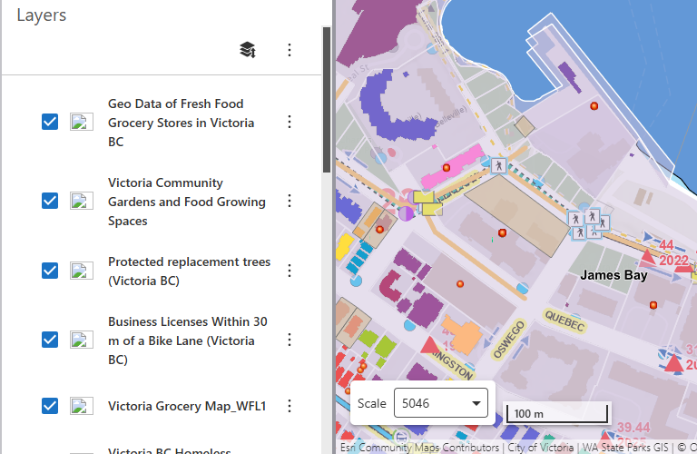
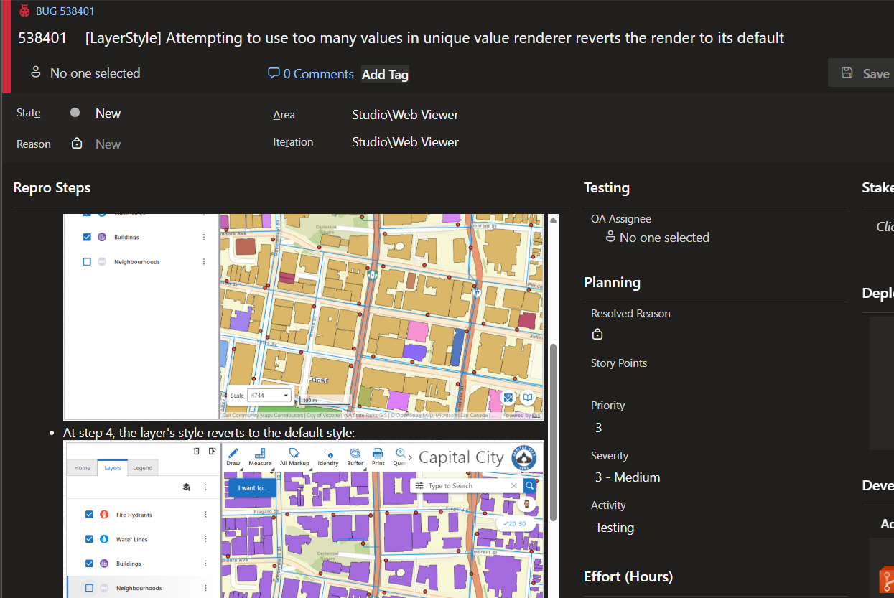

<!--
  ===================================================================
  THE PRESENTATION — edit the text in this file to change the slides.
  ===================================================================

  Full guide: EDITING.md. The short version:

  - Slides are separated by a line with just three dashes:  ---
  - "# Heading" is the big heading on a slide.
  - "- text" is a bullet point.
  - "### Heading" starts a box (card). Keep the box's lines together,
    with no blank lines inside it.
  - "**bold**" for bold, "[text](https://link)" for a link.
  - "Notes:" on its own line: everything after it is speaker notes, only
    shown in the presenter view (press P).
  - Lines at the top of a slide like "layout: demo" or "kicker: The problem"
    are settings. Leave them as they are unless you mean to change them.
  - Text in [square brackets] is a placeholder still to be filled in.

  Anything between these arrow markers is ignored, like this note.
-->

talk-minutes: 7
page-title: App Scorecard — Hackathon 2026

---
layout: title
kicker: VertiGIS Hackathon 2026
icon: scorecard
title: Title

# App Scorecard

A health check for VertiGIS Studio Web apps, built into App Designer.

- Jack Basha
- Jimmy Chung
- Omar Jawhar
- Michael Kowal
- Alisa Lindley
- Penny Berard-Toupin [Honorary]

Notes:
Introduce the team. One line: "We built a scorecard that tells you what's wrong with your app and helps you fix it, without leaving App Designer."

---
kicker: The problem
id: problem
title: The problem

# App problems stay hidden until your users find them.

- Errors and deprecated APIs in custom libraries only show up in the browser console.
- Branding gaps, like a missing description or favicon, are easy to overlook.
- Performance pitfalls, like layers re-projecting on the fly, are invisible while you design.
- App authors have to spend a significant amount of time simply trying to identify potential problem areas.

Notes:
If you can, tell a real story: an app that shipped with a broken library or a slow map. Keep this under 45 seconds.

---
kicker: Our solution
id: solution
title: Meet App Scorecard

# One click scans the app and lists what needs attention.

- Opens from the **Scorecard** button in App Designer's left rail.
- Insights are grouped into **Branding**, **Performance** and **Maintenance**.
- Each insight is sorted by priority and says what's wrong, why it matters and how to fix it.

")

Notes:
Point out the left rail button, the categories with counts, and that High items come first.

---
kicker: What it checks
id: checks
title: What it checks

# Three kinds of insights, each with a priority.

### :branding: Branding
Does the app look finished?
- No app description
- No app favicon

### :performance: Performance
Will the app be fast?
- Layers in a different spatial reference than the map

### :maintenance: Maintenance
Will the app keep working?
- Errors raised by custom libraries
- Deprecated API usage

Priorities: {High} · {Medium} · [add more checks as you build them]

Notes:
Mention that new checks are easy to add. [How many checks do you have by demo day?]

---
kicker: From insight to fix
id: fixing
title: From insight to fix
cards: compact

# Every insight comes with a way to fix it.

<!-- This list is drawn to look like the real scorecard. It's HTML, so edit the words carefully. -->
<ul class="insights">
  <li class="insight">
    <svg class="icon"><use href="#i-high"/></svg>High
    

Error in main.js Maintenance

A custom library raised an error in the preview.

    Go to Setting
  </li>
  <li class="insight">
    <svg class="icon"><use href="#i-medium"/></svg>Medium
    

No App Description Branding

Descriptions are shown in the portal and in search results.

    Add Description<svg class="icon"><use href="#i-sparkle"/></svg>Smart Fix
  </li>
  <li class="insight">
    <svg class="icon"><use href="#i-medium"/></svg>Medium
    

Layers in a Different Spatial Reference Performance

Each layer is reprojected as it draws.

    Go to Setting
  </li>
</ul>

### Go to Setting
Jumps straight to the setting that needs changing.

### :sparkle: Smart Fix
Uses AI to fix it, like writing the description. Fix All does them all.

### :dismiss: Dismiss
Hides what doesn't apply. Rescan to check your work.

Notes:
This slide is the summary of the demo. If time is short, skip it and show this live instead.

---
layout: demo
id: demo
title: Live demo
url: http://localhost:3000/#app=2b4b50401cdf493f977417d8ab1b6208
label: VertiGIS Studio Web (localhost:3000)
backup:

# Live demo — App Scorecard

Notes:
1. Open the app in App Designer and click **Scorecard** in the left rail.
2. Walk the categories: Branding, Performance, Maintenance. High items are at the top.
3. Open a High item and click **Go to Setting**.
4. On "No App Description", click **Smart Fix**. This is the wow moment.
5. Dismiss one insight, then **Rescan** and show the count go down.

The demo runs at http://localhost:3000, so start it before presenting and present from the local copy of the deck (http://localhost:8000), not GitHub Pages. If it won't load or sign in here, use **New tab ↗**. If anything breaks, use **Backup video**.

---
layout: compare
id: before-after
title: Before / after
icon: fixed
before:
before-label: Before — app as published
after:
after-label: After — scorecard fixes applied

# Before / after the scorecard fixes

Notes:
Show the same Studio Web app before and after fixing: favicon in the tab, description, faster map. Delete this slide if you don't need it.

---
layout: flow
kicker: How it works
id: how-it-works
title: How it works

# [How the scorecard is put together]

- **App Designer** — App config + live preview
- **Scorecard checks** — Branding · Performance · Maintenance (highlight)
- **Insights** — Prioritized, with what, why and how to fix
- **Fixes** — Go to Setting · Fix · :sparkle: Smart Fix

- [How a check is defined, and how easy it is to add one]
- [How errors from the preview are captured]
- [What powers Smart Fix]

Notes:
Judges like to know it's real: say what's production-ready and what's hacked together.

---
layout: stats
kicker: Impact
id: impact
title: Impact

# Better apps, without having to be an expert.

- **[N]** checks across Branding, Performance and Maintenance
- **1 click** from finding a problem to fixing it
- **[N]** [issues found in real customer or sample apps]

Notes:
If you can, run the scorecard on a few real apps before demo day and quote the numbers.

---
kicker: Development benefits
id: development
title: Development benefits

# Benefits for development and testing within VertiGIS

### Known issues
The tool can check whether known issues are still occurring, helping to identify regressions.
- BUG 538021: Layer icons copied over from another application's Map configuration retain their original resource URLs

{width=50%}

### Finding issues
The process of building the tool helped identify a new bug, and more could be found through its development.
- BUG 538401: Above a certain number of unique values, the unique value renderer reverts to the default symbology

{width=50%}

---
layout: columns
kicker: What's next
id: next
title: What's next

# [Where App Scorecard goes after the hackathon]

### Built this week
- Scorecard in App Designer
- Branding, Performance and Maintenance checks
- Go to Setting, Fix All and Smart Fix
- Dismiss and Rescan

### Next steps
- [More checks, e.g. accessibility]
- [Smart Suggestions]
- [To do]

Notes:
End on the ask: what would it take to ship this in App Designer?

---
layout: title
kicker: Thank you
icon: scorecard
id: thanks
title: Thank you / Q&A

# Questions?

App Scorecard · [link to repo or demo]

Notes:
Press G to jump to any slide during Q&A, or 6 + Enter to go straight to the demo.
